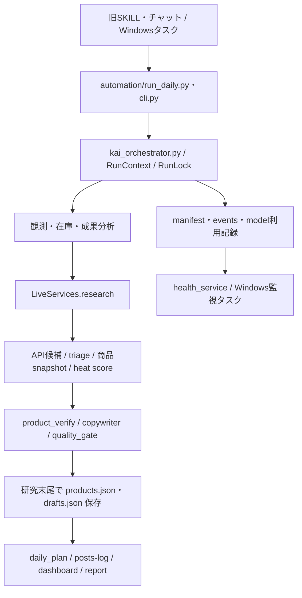

# STEP 02 過去運用障害と再利用評価

調査日：2026-09-30 JST。設計資料、現行実装、保存済みrunを読み取りで照合。旧フローを起動せず、旧データを修正していない。以下の「現行」は今回読めたファイルの状態であり、障害当日の版を復元したものではない。

## 実物の構成

入口は `.agents/skills/rakuten-room-bakemono-kai/SKILL.md`。旧スキル原本は `archive/legacy-skills/rakuten-room-bakemono-20260924/source/SKILL.md.disabled` に存在。設計文書の「未作成」は2026-09-24時点の記述であり、現在の存在状態と混同しない。

## 障害・根拠の照合

run基点：`rakuten-room-kai/orchestrator/runs/<日付>/<run_id>/`。下記位置は現行ファイルの行またはJSONフィールド。

| 事実ID・指摘 | 保存済み観測と当時/現在 | 新戦略での残り方 | 予防構成・受入試験案 |
|---|---|---|---|
| F-016 / R-001 | 09-26 `20260926-130002-daily-5b8404/outputs/research-result.json` は候補88、プール60、確認35、採用0。manifestはpartial。現在読めるsnapshot35件は在庫あり34・なし1。旧レビューの抽出障害記述だけで現在も全件nullとは言えない | 採点・取得の条件に依存。0/35を新方式の採用率に使えない | 工程別理由を残す。unknown→0変換のない境界例 |
| F-017 / R-001 | `scripts/verify-product-pages-lib.mjs:24` resolveAvailabilityは構造化在庫に加えて「在庫数」を抽出、矛盾はnull。既存テストに99,977/0/矛盾/未観測。現行改善あり。ただし販売期間の構造化フィールド・判定は今回確認した抽出/適格関数に見つからない | 在庫抽出だけで「今買える」は保証しない。ROOM化で消えない | 販売開始前/終了/在庫unknownを別状態にする。販売前で在庫999でも採用しない |
| F-018 / R-002 | 現行 `automation/research_batching.py:candidate_is_postable` は暫定A/Bを許容。旧6項目全確認必須を現在の挙動として扱わない。現行SKILLも未確認を0にしない。一方B以上と在庫/名称/価格等の条件は残る | 旧スコアは新戦略へ自動継承しない。根拠不足の評価は残り得る | 適格性と任意情報・文章主張を分ける。ショップunknownでも根拠ある文が作れる案を質問 |
| F-019 / R-003 | 09-27 `20260927-130002-daily-1c3a19/manifest.json` はresearch失敗、`CommandError: TIMEOUT`、13:00:02～13:28:21 | 外部取得・モデル処理に残る。原因工程の詳細はmanifestだけでは確定しない | 呼出単位の期限と全日予算、部分結果。認証/制限はリトライで回避しない |
| F-020 / R-004 | 09-28 `20260928-130002-daily-e9b480/manifest.json` は13:00:02～14:12:37、DATA_MISMATCH P153。`outputs/research-batches/batch-02/copy-output.json` はP153 needs_review、同batchのquality-gateはaccepted P153 | ROOM化で消えない判定矛盾 | 品質acceptedは対象下書き版のstatus・根拠・ID集合と照合。矛盾1件を隔離し他の確定成果を保持 |
| F-021 / R-004 | 過去レビューは55確認と記載。現在読める09-28 `outputs/page-snapshots.json` はrequested/observed60、unavailable0、集約heatも60。batch-01～07の出力あり。末尾copywriter.jsonにはP34 needs_reviewの1件、品質acceptedはP153/P156/P34 | **55と60の不一致は未解消**。現在ファイルが当時の不変記録か未確認。集約文だけで完全な成功を推定しない | 原入力・版・ハッシュ・工程別件数保存。後続要件では55を確定実測に引用しない。導入前に保存履歴の保全確認 |
| F-022 / R-005 | `automation/live_services.py:284～311` は全batch集約後にID/URL/status確認しdrafts→productsの順に別ファイル保存。batch証拠はあるが、正本への商品単位確定ではない。`kai_orchestrator.py:_daily` の再開はresearch-resultがある場合の再利用 | 後半矛盾で前半成果未確定、2ファイルの間で停止、再研究重複が残る | 商品/下書き/品質判定を1トランザクション（まとめて成功か失敗）で確定。14件確定後失敗・保存前後停止・二重起動を試験 |
| F-023 / R-006 | 09-26～29のmanifest heartbeatは起動時のまま。09-29 `20260929-130003-daily-1cbf5b` はrunning/performance。process.lock.meta.jsonのPID1292は今回Get-Processで見つからず | 古いrunningは実稼働の証明ではない。状態整合に残る | PID存在＋プロセス起動識別＋OSロック＋進捗時刻で照合。既存記録を自動改変しない |
| F-024 / R-006 | `automation/run_lock.py` はWindows実ロックとmeta分離、staleは古い時刻＋PID不在。`health_service.py:40～47` はmanifest時刻だけでstale判定。CodexCliRunner._invokeはポーリングするがheartbeat更新はない。定期更新呼出を調査範囲で確認できず | 長時間処理を停止と誤認する経路は残る | heartbeatと進捗更新を分離。生存中・進捗停滞・プロセス終了を別表示。長工程中も監視を更新する試験 |
| F-025 / R-007 | `inventory_service.py:29～53` は実投稿とplannedを区別しつつ、plannedを利用可能在庫から除外。期限つき予約解放は確認できず。旧 `rakuten-room/posts-log.md` はP03のみ本人実施確認、他は予定 | 未投稿を永続除外すると供給を失う。旧履歴を無視すると再投稿可能 | publication正本、期限つき予約、見送り/本人確認遅延。予定15・実投稿8で実投稿除外8のみの試験 |
| F-026 / R-008 | 現行configは確認60・batch10・6/2/2/3/2。`jobs/contracts.py:81～84` も60制約。API候補プール、ジャンル不足、追加同triageのuncertain/excludedの処理は実装済みだが別語句の再収集ループは確認できず | API検索計画依存はROOM方式で置換可能。ただし補充の設計欠落は自動解消しない | 単一の予算定義、追加検索を別search_attemptとして記録。重複ばかりの追加を新規供給に数えない |
| F-027 / R-009 | 09-28 runは現在84ファイル/6,437,708 bytes（約6.14MiB）。商品ごとの店・レビューとbatchごとの検索取得があり、横断キャッシュを調査範囲で確認できず。モデル入力はパス型でもJSON対象全体を読む設計 | 店/検索の重複取得、入力肥大化、容量は残る。旧token数は料金ではない | 店はshop_id＋期限、語はquery＋条件＋時刻でキャッシュ。必要フィールドの小batch、料金は実課金単価で別集計 |

上表はソースと保存記録の照合。旧障害を本番で再現してはいない。修正日・障害時コード版はGit履歴がないため不明。指摘の詳細・優先度はSTEP 04で統合する。

## 再利用候補

| 対象・契約 | 入出力・依存/結合 | 検証状況と提案分類 | 新規側の分離・危険な暗黙条件 |
|---|---|---|---|
| `heat-evidence-collector-lib.mjs:normalizeRakutenItemUrl/buildShopHomeUrl` | 楽天item URL→正規URL/ショップトップ。純粋関数 | **新規側へ分離して利用**。既存テストあり、今回は再実行せず | 許可host/パスとリダイレクトを検証。店舗文字列・商品文字列を誤った小文字化で統合しない |
| `verify-product-pages-lib.mjs:resolveAvailability/toSnapshot` | 構造化情報＋可視在庫→値/根拠 | **新規側へ分離して利用**。テストあり、販売期間不足 | observed/failed/unknown/conflict/staleを追加。販売期間は別部品で補う |
| `verify-product-pages.mjs:collectShopAndProductReviews` | 店トップ優先→レビュー補助、商品レビュー別取得 | **設計だけ参考**。評価件数は取るがショップ評価点の保証ではない | 新旧のブラウザ依存/出力/実行数を分離。店舗不在・点数なし・評価件数0と取得失敗を区別 |
| `room-likes-lib.mjs` / collect-room-likes | 公開ユーザーページの投稿・いいね→metrics | **調査不足**。旧プロフィール巡回で検索フィルタ取得の保証なし | 先頭50検索収集へそのまま転用しない。公開投稿対応/時刻を小規模検証 |
| `inventory_service.py:normalize_url/normalize_code` | URL/店舗商品コード→既出照合 | **設計だけ参考** | 汎用URL正規化は無関係hostまで受ける。モデル一致を別店舗禁止へ使わない |
| `atomic_io.py` / RunContext / execution_logger | JSON単一ファイル原子保存・manifest/event | **設計だけ参考** | 複数正本の原子性はない。run/checkpoint/attemptを新規命名、証拠の版固定 |
| `run_lock.py` | Windows byte lock＋pid/meta | **新規側へ分離して利用**の候補 | 旧process.lockを共有しない。PID再利用・取得権限・起動識別は追加検証 |
| `jobs/contracts.py` / schemas | モデルJSONとID/URL契約→検査 | **設計だけ参考** | 旧60、genre、score、15制約を持ち込まない。下書き版との整合を追加 |
| dashboard / publication / attribution | 本人確認、投稿URL、集計成果→正本/画面 | **設計だけ参考** | 旧products/post-statusとは別。本人修正文、部分投稿、帰属不能を保存 |
| API/認証アダプタ | 楽天検索API→候補/商品情報 | **調査不足**。接続資格・料金・制限は03へ | 認証実体をコピーしない。必要権限/設定名を設計、ROOM投稿APIとは別 |
| 加熱スコア・旧固定ジャンル/配分/60・90上限 | 旧候補の選出・採点 | **使用しない**（自動継承の意味） | 新規採用なら個別の根拠・ユーザー決定が必要 |

現段階で「そのまま共用」確定の部品はない。共用変更が旧系へ波及するため、分離した少数部品から試験する案を推奨する。

## 旧系分離・退避案

将来の新規資材は `rakuten-room-inago/`、`automation/inago/`、`.agents/skills/rakuten-room-inago/` 等の別名前空間を候補とする。新規run/正本/config/lock/環境変数/タスク名を旧と共有しない。名前はまだ提案。

旧実投稿履歴は読み取り移行候補。予定行を実投稿へ変換せず、旧ID→店舗商品鍵の対応不能は保留。同商品別店は過去に出ていても日跨ぎ許容を保持する。移行採否はQへ送る。

退避するなら、スキル・スクリプトだけでなく、設定参照・スケジューラ引数・認証の参照方法・ブラウザ依存・正本・復元手順・元配置一覧を評価する。認証ファイル/プロファイルを成果物へ保存しない。この調査では退避を実行しない。

## 状態・限界・完了確認

2026-09-30 Get-ScheduledTask観測で `RakutenRoomBakemonoKaiDaily` と `RakutenRoomBakemonoKaiHealthCheck` はDisabled。PID確認は読み取りのみ、古いmanifestも変更していない。

調査不足：09-28の55/60の差の履歴、各障害時コード版、販売期間抽出の正式契約、ショップ評価点、ROOM検索の実取得、モデル課金、公開画面と旧投稿履歴の全件対応。これらを現在実証済みとしない。

null変換と後半失敗の両方に対策・試験案を付けた。Git完了判定：管理外（git status --short失敗）。コミット・プッシュはせず、初期化しない。
