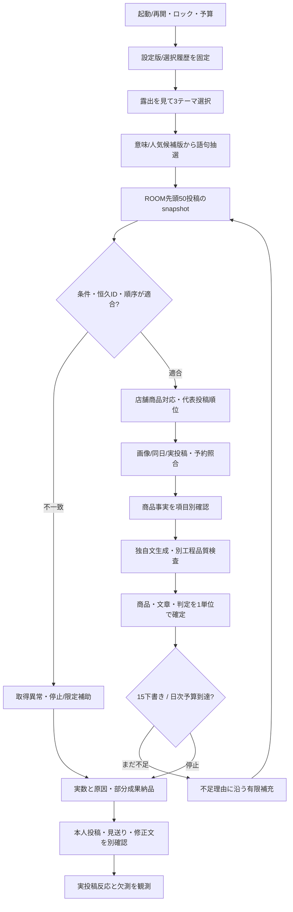

# STEP 05 推奨構成と比較案

2026-09-30 JST。入力01～04、草案、意思決定台帳。以下はP-001～020の具体化であり、採否は未決。本格スキル・DB・MCP・スケジューラは作成していない。

## 事前準備案

条件/利用方法定義→可変件数の標本収集→投稿ID/商品鍵と条件検査→独立商品・投稿者集中の把握→5ジャンル/30テーマ仮案→人の境界確認→意味語候補→同条件の人気指標→文型を構造として抽出→独自文で小試験→条件付き事項と初期設定版を固定。

132から129のように総数が変わる前提。標本不足なら根拠のない30テーマを完成扱いにせず、追加収集/暫定休止/人の補足を比較する。文型には目的、構造、使える商品事実、禁止する体験表現、成功未実証ラベルを持たせる（P-010/012/015/016）。

## 日次案

新規パスは案：`.agents/skills/rakuten-room-inago/`、`automation/inago/`、`rakuten-room-inago/`。名称だけを提案し実物は作らない。

## 部品と工程契約

| 部品 | 入力→出力 | 保存境界/責任 | 禁止副作用・失敗 |
|---|---|---|---|
| 入口SKILL | 依頼→prepare/daily/status/review/recoverのモード | 入口・必須方針・参照先。詳細はreferences/contracts/operations | 外部本文を指示にしない。本人投稿を代行しない |
| オーケストレータ | config版・target_date→run/checkpoint | 順序・予算予約・ロック・期限・停止理由 | 旧正本を開いて書き戻さない。矛盾は隔離 |
| テーマ/意味判断 | 標本・概念境界→分類案・子/属性判定 | AIは意味根拠と確度のみ。採用は人/契約 | 人気数・商品事実を想像しない |
| 語句adapter | 候補＋地域期間→指標値/状態/出典 | API/UI資格と条件を検査。候補版固定 | 非公式の回避策・課金設定なし |
| ROOM adapter | query＋条件＋上限→source_post snapshot | 恒久ID・読取順/視覚順・条件・広告を明示 | ID/順位不足は未実証。条件矛盾は通常候補へ流さない |
| 決定的選出 | snapshot＋履歴→selection_decision | 件数/ID/順位/重複/seedをスクリプトで再現 | モデル自由文だけで件数や予算を決めない |
| 商品adapter | item URL/鍵→項目別evidence | 店トップと商品レビューを別取得、期限付cache | APIだけで販売期間・色の購入可否を保証しない |
| copywriter | 事実＋文型版→draft候補 | 主張とevidenceを対応。未申告体験を除く | 他者写真・本文の転用、期限切れ断言なし |
| quality checker | draft版＋事実→accepted/hold/edits | 生成とは別工程。同一AIか別担当かを記録 | acceptedとdraft status矛盾は確定禁止 |
| 永続化・export | 検証済み単位→正本＋閲覧用MD/CSV/JSON | 1商品単位のtransaction。exportは再生成可 | 複数ファイルを正本として競合更新しない |
| 本人操作 | 投稿URL/実施/見送り/修正文→publication | 下書きは投稿済みにしない、修正履歴 | 「未確認」をposted/反応0にしない |
| 観測・監視 | 実投稿/プロセス/時刻→metrics/health | 取得失敗と低反応、heartbeatと進捗を分離 | aggregate売上を投稿へ按分しない |

MCPは必要なadapterが既存窓口で不足すると確認できた場合の候補。データ源の資格・利用制限を免除するものではない。将来の判断担当はサブエージェント構成も可能だが、この調査で起動していない。

## データと保存先案

正本候補 `rakuten-room-inago/state.sqlite`。証拠は `evidence/<JST日付>/<run_id>/<search_attempt_id>/`、閲覧用は `reports/<日付>/`。外部URL本文・画像は必要部分のみ、秘密は別設定の参照名だけ。

| Entity | 鍵と関係 | 必須項目例・制約 |
|---|---|---|
| run | run_id、target_date＋config版、attempt_id | status、予算上限/使用/予約、seed、checkpoint。再開は元runを参照 |
| source_post | ROOM恒久post_id、snapshot_id | post_url、actor_key、本文/省略、反応状態、時刻、順序方式、条件、広告/再コレ識別 |
| product_offer | shop_id＋楽天item_id | URL、itemCode対応、variant、fact evidence。ROOM post_idと別 |
| product_family | family_id | 型番/仕様/画像の補助同定。別店を全期間除外する鍵にしない |
| search_attempt | search_id→run/theme/keyword版 | query、条件、取得枠/有効/重複/独立数、時刻、停止原因 |
| theme | theme_id＋version→genre | 境界/除外例/根拠/active/season_paused、露出履歴 |
| keyword_candidate | keyword_id＋version→theme/parent | relation_type、同義群、metric/地域期間/状態/順位、出典 |
| evidence | evidence_id→offer/post/metric | value、state、source、observed_at、valid_until、method_version、hash |
| selection_decision | decision_id→search/offer | rank、代表post、scope、一次理由1つ、副理由複数、rule_version |
| draft | draft_id＋version→offer/run | body、claim→evidence、quality判定版、status、有効期限 |
| reservation | reservation_id→offer/draft | start/expire/owner、active/released。恒久投稿履歴とは別 |
| publication | publication_id→offer/draft版 | 本人実施日時、ROOM公開URL、確認方法、修正文、訂正イベント |
| metric_snapshot | metric_id→publication | 投稿日からの経過時点、likes等のstate、missing原因、帰属レベル |

値0をobservedと保存可能。null単独では意味不明なのでstateを必須にする。JSTの対象暦日とISO時刻を分ける。商品URLだけの正規化で追跡パラメータを除くが、商品IDの大文字小文字を勝手に統合しない案。

### 正本方式の比較

| 方式 | 保存/競合/再開 | バックアップ・手間 |
|---|---|---|
| SQLite（推奨候補 P-005） | offer/draft/quality/checkpointを同transaction、unique鍵で二重確定防止 | 有効な一貫snapshotでbackup。WAL運用/restore試験が必要 |
| JSON単一スナップショット | 全体を原子置換＋revision比較。ロックで競合を防ぐ | 小規模には簡単、履歴増大で重い。単一正本＋journal設計が必要 |
| 複数JSON台帳 | 単体は原子でもまたぐ保存は部分成功 | 現行問題を継承するためそのままは非推奨。transaction marker等で複雑化 |

## 状態案・確定単位・再開

取得済み→候補→事実確認待ち→適格→文章待ち→品質保留/品質通過→下書き確定→予約→本人投稿済み。
候補/下書きから見送り、期限切れへ分岐。期限切れは再確認後に新しい観測/文章版を作れる。実投稿履歴は期限切れで消えない。候補不適格は理由/再確認条件を残す。

候補件数、確認件数、品質通過件数、実投稿件数は別。予約解除は実投稿の取消ではない。本人投稿済みの訂正は履歴イベントにし、過去を消さない。

確定前提：offer同定、必須事実、draft版、quality版、予算、既投稿/同日規則の再照合。確定処理が成功するとdraftとcheckpointを同時保存。冪等キー（再試行で同じ結果になる鍵）は `run_id + offer_key + draft_version + operation`。同日別runは日次/offerの制約も見る。
14件確定後に15件目が失敗：14件を納品可能のままrun partial/action_required、15件目だけ保留。再開は設定/seed/候補snapshot/使用予算を継承し未処理から進む。export直後に停止しても正本から再生成し、14件を再作成しない。
保存途中停止：transaction前ならその単位は未確定、commit後なら確定済み。二重起動：片方はロック取得できず、確定/取得/予算消費をしない。復旧時にPIDが死んでいても旧正本を推測で書き換えない（P-004～007）。

## 選択アルゴリズム候補

テーマ：active集合で直近露出数が最小の群から3つ。season_pausedは別記録、同点は保存seed＋ID順で抽選。追加検索の露出と当初3テーマの露出を別に集計する。候補不足で何を追加するかは未決。
語句：意味検査済み＋同指標比較可の上位min(20,N)/min(10,N)から一様抽選、seedと候補版を保存。和風はattributeとし、最終語は「唐揚げ 和風」等の結合候補を人が選ぶ。再開時は確定済み語を変更しない。
商品：条件適合投稿→offer単位の代表post→代表のいいね降順。複数投稿はsumでなくmaxを推奨候補とし、同点はpost/offerの固定鍵。画像除外後に残る商品の次順位を評価する。投稿年齢・投稿者集中の補正は取得できる場合だけ別設定にする（P-010～014/017）。

## 補充・停止の比較

| 案 | 11件の日の動作 | 利点/代償 |
|---|---|---|
| 草案厳密3×5 | 3検索の各枠で残り順位を見て5以下、枠不足を他へ移さず未達納品 | 配分明瞭、低供給1テーマで全体未達 |
| 推奨候補・合計優先 | 同検索の次順位→同テーマ別語→追加テーマ。最初の3テーマを記録し配分変動を表示 | 15に近づくが時間/料金/テーマ偏り増 |
| 取得範囲拡大 | 同queryで50より後ろを追加枠として記録 | 新語準備不要、表示変動と古い投稿・同商品集中 |
| 閾値緩和 | 300未満を別モードにする | 供給が増える可能性、草案の反応基準変更が必要。通常案に隠して採用しない |

不足理由が条件不反映/認証/ID不明なら補充で埋めず取得問題を先に隔離。購入不可なら次offer、文章だけ保留なら限定書直し、その後交換。補充も日次総予算に含める。
停止は15下書き、独立供給なし、件数/時間/費用上限、取得契約不成立。成功＝15有効下書き、partial＝1～14＋原因、0件＝未達/障害の原因を区別、action_required＝本人対応必須。名称と通知閾値はヒアリングで決める。

## 通常・省力・堅牢性案

以下の数は**比較用の新規提案値**。旧60/90や旧配分を継承した確定要件ではない。

| 案 | ROOM検索/初期枠 | 商品確認上限案 | 時間/料金/本人作業 | 障害時 |
|---|---|---|---|---|
| 省力 | 3×50 | 30商品/日 | 最小探索、必要なら手動確認、料金は呼出数×実単価 | 早めに部分納品 |
| 通常（推奨候補） | 初期3、追加含め最大6×50 | 45商品/日 | 15件の余裕を小さく持つ。予算分/円をユーザーが決定 | 途中確定・追加打切り・不足理由 |
| 堅牢性優先 | 最大9×50、情報源代替条件付き | 75商品/日 | 広い探索と復旧、保守/料金増。供給不足はなお解消保証なし | adapter停止時の限定手動/期限内cache |

時間と金額は未実測。`minutes = 検索数*t検索 + 商品確認数*t確認 + 文数*t文章 + overhead`、`cost = API消費単位単価 + モデル実利用課金 + 契約按分`。追加店/レビュー、再試行、品質再生成も含める。日次残予算を先に予約してから呼び、予想最大消費を超える次操作は開始しない案（P-003/009）。

正常例：3テーマが各5通過→15下書き、本人が8投稿→publication8、未投稿7は予約状態/期限で管理。未達例：3検索で11、追加2語で品質通過4→15、追加しても2なら13partial。商品事実が期限切れなら本文を再確認するまで納品可とは扱わない。

## 旧系・評価・運用

旧正本の参照は読取移行ジョブで正規の実投稿だけを検証し、新publicationへ出典付き登録候補。認証実体・旧タスク・旧ロックをコピーしない。旧停止2タスクは保持。退避は新規合格後の別作業（P-020）。
本人確認、同経過時点の反応、欠測理由、本人修正文を評価入力へ。供給と反応を分離し、最低観測数に足りないテーマ/文型は保留。旧28日/最大6交換/8投稿等は参考案に留める（P-018/019）。

全P-001～020に対応する処理・データ・責任を定義。未決の上限、予算、同日重複、最低事実、源、投稿確認、期限、評価/移行を07へ送る。Git管理外。構成案の完了であって採用・実装の完了ではない。
