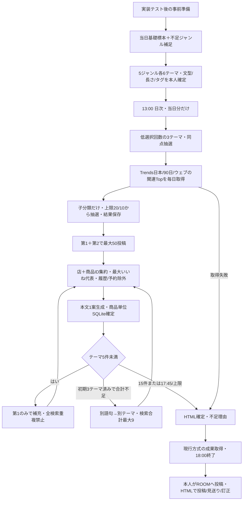

# STEP 11 決定事項と残課題

2026-09-30 JST。状態：回答統合済み・要件書執筆へ。STEP 01～10、草案2文書、全回答とD-001～059を照合。本人の判断を変更する未回答はない。導入前の取得・保存実証は条件付き採用で、実装担当がテストし本人が本番開始/不成立対応を判断する。ここで新スキル・タスク・旧正本を変更しない。

## 回答の分類と変更の優先順

基本Q-001～041は全回答済み。補助Q-012-a/b、017-a、020-a、021-a/b、027-a/b、031-a、035-a、036-aは回答済み。031-aは再表示回答、014は選択ミス訂正のAが正本。
本文長さ/タグは事前分析後の本人確認という条件付き決定（D-021/022）。ジャンル名と30テーマは事前標本に基づく本人確定（D-004/006/026/027）で、今架空の分類名を確定しない。
不要な枝：最低商品事実/再確認B-002、追加禁止一覧Q-014-a、通知先B-010、月次自動入替の最低量/上限B-006、試験7日/30日や段階増量B-012。本人は確認ゲート・通知・自動入替・長期試験を採らない。
旧06/05の提案と07の選択肢を本人決定へ流用しない。後の回答が優先する変更は、D-007→023の収益優先、D-020の訂正と表現検査不要、D-043→052の探索締切18:00→17:45、Q-039提案→D-055の実装テスト後最初から本番。
読者に架空体験を実話と誤認させる/根拠のない事実の断言を作る追加指示は原文を保持するが、このエージェントの引受範囲外としてD-023に記録済み。これを生成機能の採用要件へ昇格させない。商品事実・文章検査のゲートを追加することとは別である。

## 確定フロー

0子分類は取得成功の結果として別語句/テーマへ移る。取得失敗は当日の語句選び停止。事前全標本の収集と日次9検索は別処理。作成確定した本文はいつでも部分HTMLへ出せる。商品ページ再確認や別品質承認ジョブを挟まない。

## 主要パラメータの正本

| パラメータ | 値/数える対象 | 決定 |
|---|---|---|
| 成功/優先 | 収益を目指す。実測利益を保証しない | D-023/050 |
| 日次生成 | 15商品各本文1案、合計優先、初期3テーマ各5 | D-003/008/009/018 |
| 分類 | 5ジャンル×6テーマ、主1＋補助、重なり許容 | D-027/028 |
| 人気条件 | ROOMいいね300以上、代表最大値、同点乱数 | D-010/011 |
| 取得順/枠 | 内部取得順、1検索先頭最大50投稿、全9試行最大450枠 | D-025/044 |
| 語句 | 子分類のみ、Top関連相対人気、上限20/10、実数使用 | D-029/032/058 |
| 人気対象 | 日本/日本語/ウェブ/過去90日、毎日更新 | D-033/036 |
| 選択 | テーマの低選択回数優先、語は単純抽選、seed/結果保存 | D-034/035 |
| 検索順 | 第1＋第2→5件不足時第1のみ→別語句→別テーマ | D-030/044 |
| 重複キー | 店舗＋商品ID、別店舗/別ID許容、画像同一でも別商品確認時許容 | D-012～014 |
| 商品確認 | 完成条件なし、再確認なし、確認不足の保留/交換なし | D-016/017 |
| 生成失敗 | エラー/空本文のみ初回＋最大2回、継続失敗で別候補 | D-019 |
| 実投稿/予約 | 本人投稿、未投稿は投稿/見送り報告まで予約、期限解放なし | D-015/046/059 |
| 日次時間 | JST13:00開始・17:45本文終了・18:00成果終了 | D-039/042/052 |
| 追加料金 | 新規サービス契約/従量API0円、既存契約内 | D-040 |
| 通知 | 送信しない。HTMLと状態一覧を本人確認 | D-048 |
| 正本/再開 | SQLite商品ごと確定、二重防止、確定本文再生成なし | D-047 |
| 保持 | 実投稿/除外キー/未解決予約は運用中、取得詳細90日、成果集計1年 | D-049 |
| 保全 | 同PCプロジェクト外へ日次、月1回別領域復元確認 | D-051 |
| 成果 | 作成後日次で現行化け物・改の取得方式、欠測/未確定/帰属分離 | D-050/052 |
| 変更 | 本人随時変更、システムは記録を提示・自動入替なし | D-053 |
| 導入 | 実装後テスト→初めから本番、随時デバッグ、期間付き試験なし | D-055 |
| その他取得再試行 | 一時障害のみ初回＋最大2回、締切/検索上限と語句失敗停止優先 | D-056 |
| 実行 | 現Windows・新スキル/スクリプト・自動/手動、MCP必要時検討 | D-057 |

## 指摘・提案の採否と残余リスク

同番号R/P/ACの採否を下表に対応。04のAC候補をそのまま合格条件にせず、本人の回答に沿う受入条件へ置き換える。

| R/P/AC | 採否と現構成 | 根拠D | 消してはいけない残余リスク |
|---|---|---|---|
| 001 | 商品事実ゲート・期限チェックは不採用。未知は0にしない | 016/017 | 販売前/情報変化でも下書きを作る |
| 002 | 旧B/6項目ゲート不採用 | 016 | 商品評価の保証はない |
| 003 | 有限再試行/終了は採用、語句失敗は即当日停止 | 019/033/044/052/056 | 取得不能日は15未達 |
| 004 | 商品ID/本文版/保存状態整合は採用、別品質判定は不採用 | 016/047/057 | 生成内容の別評価はない |
| 005 | SQLite商品単位commit/部分再開採用 | 047 | 実装後停止注入試験が必要 |
| 006 | ロック/生存/進捗分離採用、通知なし | 047/048/056 | 本人が確認しないと障害見逃し |
| 007 | 実投稿分離採用、期限付解放案は不採用・無期限予約 | 015/046/059 | 未報告で供給圧迫 |
| 008 | 合計15・有限補充採用 | 008/009/030/044 | 供給がなければ検索増加でも不足 |
| 009 | 費用0/時刻/試行上限採用、固定分数/旧確認上限不採用 | 040/041/044/049/052 | 既存契約利用量/実時間は実測必要 |
| 010 | 関連Topの代理指標、子分類フィルタ採用 | 029/031/032/036/058 | 子分類0、絶対検索数でない |
| 011 | 内部順50/閾値記録採用、画面順位案不採用 | 010/024/025 | 50件/ID継続取得は導入前実証 |
| 012 | 最大値代表・文型を仮説採用、強制補正/因果主張なし | 010/011/037/050 | 商品・投稿者・文型の効果を分離しきれない |
| 013 | 店舗＋ID、別店舗/別ID許容、family除外不採用 | 012/014/015/046 | 同型商品の紹介が並ぶ |
| 014 | 画像のみの全除外に例外 | 013/014 | ID不明の画像衝突は人判断 |
| 015 | 本文1案、空/エラー再試行のみ、表現検査ゲート不採用 | 016～023 | 別評価なし。引受範囲の制約はD-023 |
| 016 | 5×6・標本全結果/補足最大250・子分類 | 026～030/038/058 | 少ないジャンル・語は作れない場合 |
| 017 | 低選択回数と保存乱数採用 | 034/035 | 投稿/反応の均等までは保証しない |
| 018 | 欠測/実投稿/収益単位分離、日次取得採用 | 045/050/052 | 注文商品一致は入口投稿の証拠でない |
| 019 | 自動/月次入替は不採用、本人随時変更 | 053 | 季節対応や見直しの遅れ |
| 020 | 新名前空間・純粋部品再利用、合格後旧退避採用 | 001/006/015/054/055/057 | 旧依存/認証/出力先は移植テスト必要 |

## 検証条件・不成立時・期限・責任

条件付き要件は「後で考える」とせず次の手順へ固定する。取得方式は公開ROOM UIと無料Trends UIに選択済み、少量可視取得の成立は03/09で確認済み。自動継続や50件は未確認であり、実装者が実装後テスト・最初の本番使用前に検証する。期間付き試験運用は要求しない。

| V | 採る手順/合格・判断期限 | 不成立時 | 責任 |
|---|---|---|---|
| 001 | 1検索を最大50投稿まで取得、DOM順/300/件数/終了を手照合。日次初使用前 | 部分HTML、当該取得停止。本人対応/手動入力 | 実装者実証・本人代替判断 |
| 002 | 少量投稿→商品URL→店舗＋IDを手照合。同画像別ID/既投稿キー/本人チェック保存を実装テスト | 識別不能候補を独立商品へ加算しない、手動URL/ID補完 | 実装者・本人補完 |
| 003 | 日本90日Webの関連Top取得/更新完了/子分類フィルタ/0と失敗を区別。初語句使用前 | 0は他語句/テーマ、失敗は当日停止。paid要求なら停止/無料案再判断 | 実装者・本人 |
| 004 | 不採用。商品事実/再確認の適格性試験を導入ゲートにしない | 未取得事実を0へ変換しないデータ試験に置換 | 実装者 |
| 005 | 14件後停止/commit前後/同日再開/二重起動/チェックと選出競合。実装完了時 | 確定本文保持、整合違反停止、本人/保守担当再開判断 | 実装者・保守担当 |
| 006 | ロック/プロセス/復元/月次復元/旧履歴移行と新旧出力分離。初稼働前と復元月次 | 新処理停止、旧タスク停止維持、実投稿履歴優先復旧 | 実装者・本人 |
| 007 | 初めから本番で各工程時間/供給/生成失敗/本人作業/容量を測定。随時デバッグ | 未達実数と原因表示、既決上限を黙って緩和しない | 実装者計測・本人変更判断 |
| 成果補足 | 現行取得CLIの出力先/認証依存を新系へ分離、旧JSONが変わらないこと、17:45～18:00共有上限をテスト | 本文保持、成果欠測、本人再ログイン/保守 | 実装者・本人認証 |

5ジャンル×6テーマ/本文長さ/タグの確定は、事前基礎標本＋不足時最大250を分析して一覧と根拠を提示し、本人確認を受けた時。材料不足なら不足を表示し、本人が追加材料を指定または分類の見直しを判断するまで日次分類を確定しない。架空の30テーマ根拠で開始しない。事前準備は日次15作成と別モード。

## 実装側に委ねる詳細の具体化

提案値は本人回答を装わず、既決を守る実装仕様として次章へ引き継ぐ。
新設定/SQLite/ロック/run/HTMLは rakuten-room-inago、処理は automation/inago、スキルは .agents/skills/rakuten-room-inago の新名前空間を初期設計とする。旧コードの副作用依存を直接接続しない。
バックアップ初期先は C:/project/rakuten-room-inago-backups、復元作業はその配下のrestore-check。正本の整合バックアップは日次7世代、月次に使い捨ての復元用コピーを検証し稼働DBへ上書きしない。取得詳細は日付キーで90日窓のコピーを保持し、期限を越えた詳細をバックアップ/復元から復活させない。恒久キー/未解決予約は期限削除しない。PC故障に備える別媒体は今回の採用範囲にない。
heartbeat初期間隔30秒、2分以上未更新/10分以上進捗なしを「要確認」の画面表示に用いる。生存証拠のないrunningをhealthyとしない。この値は専門側初期値で、過去timeoutや本人指定ではない。自動解除/プロセス強制終了を停滞表示だけで行わない。
工程の呼出timeoutは固定旧600秒を継承せず残り工程時間で抑える。本人操作の待ち時間で日次を無限に延長しない。復旧は同日締切内の未確定部分のみ、締切後の旧runは保存/HTML再出力/本人状態訂正を許し新検索を再開しない。

## 回答後の30/90/365日再試算

[入力](simulation/回答後計算入力.json)、[結果](simulation/回答後計算結果.json)。11条件×3期間＝33行。同入力2回一致、保存則/9試行/0追加料金/恒久消費と予約の二重計上なしを算術確認。実データ予測ではない。

仮定：初期利用可能な店舗商品120、新規18/日（比較は12/4）、検索増分枠[12,11,10,9,8,8,7,7,6]、集中条件[4,5,4,5,5,5,4,4,4]。各検索50投稿枠、検索間の重複は増分枠に織込み、候補が独立という確率積は使わない。初期3テーマ各5、不足はそのテーマの第1のみ、最後に別語句/テーマで補い最大9。商品事実/別品質の除外率は0。空/エラーのみ初回＋2回で候補交換。未投稿は報告まで予約、見送り条件のみ翌日に明示解放。全件当日投稿を標準とし、8/15投稿条件はfloor(D×8/15)。実投稿/見送り以外に予約を解放しない。

再現算術：各日、前日明示見送り予約を解放→新規供給をpoolへ加算→available=max(0,pool−reserved)。検索ごとfit=min(増分枠,available−当日試行済み)、テーマ残枠または合計15まで本文生成。生成失敗候補は当日再選出せずpoolから恒久消費しない。初期3テーマそれぞれ第1＋第2、5未満なら第1のみを次の検索枠として数える。合計不足は残予算検索。語句源停止日はROOM0検索。P=floor(D×投稿率)、pool-=P、reserved+=D−P。明示見送りは次日予約を解放。日次D/P/失敗/検索/期末予約を加算する。

| 条件 | 日数 | 下書き | 実投稿 | 未達文数 | 15達成日率 | ROOM試行 | 期末予約 |
|---|---:|---:|---:|---:|---:|---:|---:|
| 新規18/日・全件当日投稿 | 30 | 450 | 450 | 0 | 100% | 90 | 0 |
| 新規18/日・全件当日投稿 | 90 | 1350 | 1350 | 0 | 100% | 270 | 0 |
| 新規18/日・全件当日投稿 | 365 | 5475 | 5475 | 0 | 100% | 1095 | 0 |
| 06と同じ新規12/日・全件投稿 | 30 | 450 | 450 | 0 | 100% | 90 | 0 |
| 06と同じ新規12/日・全件投稿 | 90 | 1200 | 1200 | 150 | 44.44% | 570 | 0 |
| 06と同じ新規12/日・全件投稿 | 365 | 4500 | 4500 | 975 | 10.96% | 3045 | 0 |
| 共通商品集中・新規18/日 | 30 | 450 | 450 | 0 | 100% | 150 | 0 |
| 共通商品集中・新規18/日 | 90 | 1350 | 1350 | 0 | 100% | 450 | 0 |
| 共通商品集中・新規18/日 | 365 | 5475 | 5475 | 0 | 100% | 1825 | 0 |
| 新規4/日・全件投稿 | 30 | 240 | 240 | 210 | 33.33% | 210 | 0 |
| 新規4/日・全件投稿 | 90 | 480 | 480 | 870 | 11.11% | 750 | 0 |
| 新規4/日・全件投稿 | 365 | 1580 | 1580 | 3895 | 2.74% | 3225 | 0 |
| 31～90日は供給6/日・検索枠55% | 30 | 450 | 450 | 0 | 100% | 90 | 0 |
| 31～90日は供給6/日・検索枠55% | 90 | 1020 | 1020 | 330 | 58.89% | 492 | 0 |
| 31～90日は供給6/日・検索枠55% | 365 | 5145 | 5145 | 330 | 89.86% | 1317 | 0 |
| 31～37日語句源停止・ROOM検索なし | 30 | 450 | 450 | 0 | 100% | 90 | 0 |
| 31～37日語句源停止・ROOM検索なし | 90 | 1245 | 1245 | 105 | 92.22% | 249 | 0 |
| 31～37日語句源停止・ROOM検索なし | 365 | 5370 | 5370 | 105 | 98.08% | 1074 | 0 |
| 新規12/日・8/15投稿・残り未報告 | 30 | 450 | 240 | 0 | 100% | 90 | 210 |
| 新規12/日・8/15投稿・残り未報告 | 90 | 1200 | 620 | 150 | 44.44% | 570 | 580 |
| 新規12/日・8/15投稿・残り未報告 | 365 | 4500 | 2270 | 975 | 10.96% | 3045 | 2230 |
| 新規12/日・8/15投稿・残り翌日見送り | 30 | 450 | 240 | 0 | 100% | 90 | 7 |
| 新規12/日・8/15投稿・残り翌日見送り | 90 | 1350 | 720 | 0 | 100% | 270 | 7 |
| 新規12/日・8/15投稿・残り翌日見送り | 365 | 5475 | 2920 | 0 | 100% | 1095 | 7 |
| 最初の1候補は3回生成失敗・交換 | 30 | 450 | 450 | 0 | 100% | 90 | 0 |
| 最初の1候補は3回生成失敗・交換 | 90 | 1350 | 1350 | 0 | 100% | 270 | 0 |
| 最初の1候補は3回生成失敗・交換 | 365 | 5475 | 5475 | 0 | 100% | 1095 | 0 |
| 全商品事実不明・生成成功 | 30 | 450 | 450 | 0 | 100% | 90 | 0 |
| 全商品事実不明・生成成功 | 90 | 1350 | 1350 | 0 | 100% | 270 | 0 |
| 全商品事実不明・生成成功 | 365 | 5475 | 5475 | 0 | 100% | 1095 | 0 |
| 全候補が3回生成失敗 | 30 | 0 | 0 | 450 | 0% | 270 | 0 |
| 全候補が3回生成失敗 | 90 | 0 | 0 | 1350 | 0% | 810 | 0 |
| 全候補が3回生成失敗 | 365 | 0 | 0 | 5475 | 0% | 3285 | 0 |

供給12/日を旧06と同じにすると、全件当日投稿の現在条件では年間4,500、未達975、15達成日は40/365。旧06の8/15投稿＋期限予約の5,475下書きは現在構成の保証に使えない。全件新規投稿の必要新規供給は平均15以上/日＋変動余裕。供給4/日は初期120+4×365=1,580が消費上限で、9検索でも増えない。
未報告条件では年間2,230予約が滞留し4,500下書きで供給制約に達する。一方、本人が見送りを明示すれば同店舗商品を将来再選出でき、同じ供給でも5,475下書きを作れる仮定例になる。これは別商品5,475の供給を意味しない。予約期限は本人の無期限方針を維持し、強制解放へ変更しない。
語句源が7日停止すると105件不足、古い語句自動流用はしない。全商品事実不明でも生成成功なら通常条件と同じ件数。全生成失敗では0件、最大9検索と候補ごとの3生成呼出で有限停止。
時間/容量は仮換算：検索1.5分、生成1試行0.2分、固定3分、成果10分、取得投稿2KiB、本文4KiB。通常年間7,482.5分・粗128.32MiB、90日原記録窓26.37MiB。全生成失敗仮定でも日73.3分。285分の本文枠/15分の成果枠に実測で収まる証拠ではない。Trends取得時間、証拠索引、DB、backup、ネット待ち、モデル利用量は未換算で実装後測定する。追加サービス費用は採用方針0円、既存契約の原価/トークン価格見積ではない。

## 一日の具体例と未解決の扱い

正常：13:00開始、3テーマで15本文を商品ごと確定、HTML納品後成果取得、18:00までに終了。本人のチェック15件だけが実投稿履歴になる。
未達：第1＋第2で4/4/5、各不足を第1のみで1/1補い5検索で15。新規供給が11なら残り検索でも同じ候補しかなく11件納品、試行/独立商品/既投稿/予約/生成失敗の内訳を表示する。
障害：14件commit後に停止、HTMLへ14件、同日締切内なら15件目の未確定処理だけ再開。同じseed/語句/残予算。締切以降は新探索せず翌日当日分のみ。作成日の14件は本人が翌日投稿でき、事実再確認しない。
本人8投稿：posted8と予約7を分離。未チェック7を実投稿0反応にしない。HTML見送りした分だけ予約解放、誤チェックは訂正理由の履歴を保持する。

取得UIの継続性、独立新商品の量、本人の報告率/作業時間、売上効果は未実測の残余リスク。採った振る舞い・試験責任・不成立時の動作は定義済みで、必須の「後で考える」TBDとしては残していない。詳細仕様/受入条件へ12で展開する。

